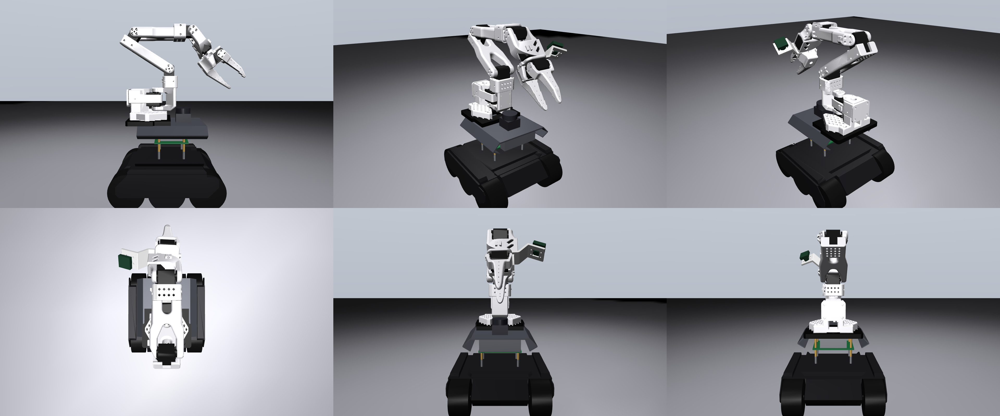

# so101_rover_description

URDF / MJCF of a **Waveshare UGV Rover (Jetson Orin ROS 2 kit)** carrying an **SO-101 follower arm** on a
3D-printed adapter plate, with a **Waveshare 160° USB camera** on the wrist and the **OAK-D Lite** at the rover's
front. Checked for Isaac Sim, MuJoCo, Gazebo and RViz. Matched to the robot as built on 24 Oct 2026, against the
photos in `reference_photos/`.



## What is in the model

| Part | Source | Notes |
|---|---|---|
| Lower body, LiDAR, front OAK-D Lite, 4 driven wheels | Waveshare `ugv_description/urdf/ugv_rover.urdf` | body mesh cut at its real flat top (0.093 m); Waveshare's mesh carries a 2.8 cm cover the Jetson kit does not have |
| 2 passive middle wheels | added | the rover has 6 wheels, 4 driven; collision cylinders, the body mesh draws them |
| Upper deck, brass pillars, Jetson Orin Nano | added, schematic boxes | folded tray (125 mm top, sloped walls to 160 mm), top 0.175 m above ground (measured); the printed plate overhangs its rear edge by ~27 mm as on the robot |
| Printed adapter plate | `SO101_UGV_Rover_Mount/FINAL_FILES/01_adapter_print_1.stl` | bolted flat on the deck, triangle toward the rear |
| SO-101 follower arm | TheRobotStudio `Simulation/SO101/so101_new_calib.urdf` | links prefixed `arm_`; joint names unchanged and in LeRobot order: `shoulder_pan shoulder_lift elbow_flex wrist_flex wrist_roll gripper`; reaches **forward** over the LiDAR |
| Wrist camera | official SO-101 wrist mount redrawn for the 25×24 mm Pi-board camera (`scripts/make_wrist_mount.py`) + Waveshare 160° USB camera | same mount pose and optical axis as TheRobotStudio's wrist camera; `--wrist-mount v2` gives the old rod bracket |
| Optional | 3S Li-ion arm battery (`--arm-battery`, stands on the lower body behind the Jetson; the deck top has no room), 6 mm spacers (`--spacer 0.006`) | not fitted as built |

**Frames** follow ROS conventions. `base_footprint` is on the ground and `base_link` is 0.081 m up, with x forward and z up.

| Frame | What it is |
|---|---|
| `front_camera_optical_frame`, `wrist_camera_optical_frame` | camera frames: z along the optical axis, x right, y down |
| `wrist_camera_link` | camera body frame: x along the view direction |
| `arm_gripper_frame_link` | point between the fingertips |
| `base_lidar_link`, `base_imu_link` | LiDAR and IMU, from Waveshare |

**Sensors**

| Sensor | Field of view | Range |
|---|---|---|
| Front OAK-D Lite (RGB) | 69° × 54° at 4:3 | 0.05 to 20 m |
| Wrist USB camera | 160° fisheye; simulated as 120° pinhole | 0.02 to 5 m |
| LiDAR | 360° | 0.02 to 12 m |

All three are in the URDF's `<gazebo>` blocks. The MJCF carries the two cameras as `front_camera` and `wrist_camera`, plus a `gripper_frame` site. Collision shapes are in MuJoCo group 3, hidden by default, so they never block a camera.

## Files

```
urdf/so101_rover.urdf          ROS version   (mesh paths package://so101_rover_description/meshes/...)
mujoco/so101_rover_sim.urdf    plain version (mesh paths ../meshes/...)  -> Isaac Sim, Gazebo without ROS, other tools
mujoco/so101_rover.xml         MJCF: free-floating rover on a floor, actuators, cameras  -> MuJoCo
export/so101_rover_assembly.*  whole robot as one STL (m and mm) and a coloured GLB, arm in a display pose
export/view_*.png              renders from the same angles as reference_photos/
meshes/rover|so101|mount       STL meshes (rover and arm in metres, printed parts in mm with scale 0.001)
scripts/build_urdf.py          builds both URDFs from the upstream files in source_models/
scripts/build_mjcf.py          builds the MJCF from the plain URDF
tests/check_model.py           read-only checks: URDF tree, meshes, inertias, measured heights, 3 s MuJoCo run, camera images
tests/export_views.py          STL / GLB export and reference renders
reference_photos/              photos of the real robot the model was matched to
```

## Using it

**Isaac Sim**: File → Import → URDF and pick `mujoco/so101_rover_sim.urdf`.

- Keep "merge fixed joints" on.
- Set the four driven wheel joints to velocity drive, the arm joints to position drive, and the middle wheels to no drive.
- Mesh paths are relative, so no ROS is needed.
- The importer renames `3d_camera_link` to `_3d_camera_link`, because prim names can't start with a digit. The name is kept so the TF frame matches Waveshare's ROS stack.

**MuJoCo**: `python -m mujoco.viewer --mjcf mujoco/so101_rover.xml`. The control vector is:

1. the 6 arm joint targets in radians, in LeRobot order;
2. then the 4 driven wheel speeds in rad/s: left up, left down, right up, right down (velocity servos, torque limited to 2 Nm).

Use the MJCF, not the URDF. Loaded raw, the URDF welds the rover to the world.

**ROS 2**: copy the folder into your workspace, run `colcon build`, then `ros2 launch so101_rover_description display.launch.py` for RViz with joint sliders.

**Rebuild** after changing a parameter:

```bash
python3 scripts/build_urdf.py [options] && python3 scripts/build_mjcf.py
python3 tests/check_model.py && python3 tests/export_views.py
```

The build writes `urdf/build_params.json`, and the test checks the model against those parameters. Every option in the table below builds and passes.

```bash
# example
python3 scripts/build_urdf.py --spacer 0.006 --arm-battery && python3 scripts/build_mjcf.py
```

| Option | Default | Use |
|---|---|---|
| `--deck-height` | 0.175 | ground to top of the upper metal deck, m |
| `--lidar-to-yaw` | 0.065 | LiDAR centre to the arm's yaw axis, m (read off the photos) |
| `--spacer` | 0 | spacer height under the plate, m |
| `--arm-battery` | off | add the 3S arm battery, standing on the lower body behind the Jetson |
| `--wrist-mount` | pi | `pi` = current mount; `v2` = the rod bracket that broke; `none` = no wrist camera |
| `--arm-facing rear` | front | the plate's other orientation (arm reaches backward); needs `--lidar-to-yaw 0.09` or more, or the base hits the LiDAR |

Python needs `numpy scipy lxml yourdfpy mujoco trimesh pillow`.

## Key dimensions (as modelled)

| | value |
|---|---|
| Ground → top of the upper metal deck | 0.175 m (measured) |
| Ground → underside of the SO-101 base | 0.185 m (deck + 10 mm plate) |
| Ground → top of the lower body | 0.093 m (from the photos; 9.2 cm from the lower body to the arm base) |
| LiDAR centre → arm yaw axis | 0.065 m |
| Wheels | 80 mm diameter, 6 wheels (4 driven), 85.5 mm pitch (Waveshare CAD, matches their 253 mm overall length) |
| Total mass | 4.46 kg (rover body 2.37 + 6 wheels 1.24, arm 0.63, plate 0.11, LiDAR + OAK 0.09, wrist camera 0.03; no battery) |

## Known approximations

1. **Lower body to arm base:** 9.2 cm in the model against your 8.5 cm tape measurement. The photos give 9.3 cm, so the model follows the photos.
2. **Arm fore/aft position:** read off the photos, good to about ±1 cm. Measure the LiDAR centre to the centre of the arm's first motor and pass `--lidar-to-yaw` to make it exact.
3. **Wrist camera:** placed at TheRobotStudio's official wrist-camera pose. The real lens may sit a few mm off, depending on where the board lands in the slots; calibrate against a real image if precise extrinsics matter.
4. **Deck, pillars and Jetson:** simple boxes at the positions and heights measured from the photos.
5. **Printed parts:** box inertias. The rover and arm inertias are the upstream values.

## Printing the parts

The two printed parts on the robot are in `meshes/mount/`, at true size in millimetres:

- `rover_adapter_plate.stl`: black PETG, 60% infill.
- `wrist_cam_mount_pi_board.stl`: the wrist camera mount. Print `export/print/wrist_cam_mount_pi_board_PRINT.stl`
  as supplied (standing on its 35 mm-wide edge, the orientation with the least overhang): PETG or ASA, 0.2 mm layers,
  4 walls, 40% infill, supports from the build plate only, 5 mm brim. Fit the camera with 4 × M2 × 8 screws and M2
  nuts; the slots take 20–21 × 12.5–13.5 mm hole patterns. Two M3 × 8 screws hold it to the wrist's two threaded holes.
- Variants of the wrist mount, from `scripts/make_wrist_mount.py` (`--offset` moves the camera sideways away from the
  gripper body, `--extend` moves it back, `--tilt auto` re-aims it at the fingertips); each has a `_PRINT.stl` in
  `export/print/` and an entry in `meshes/mount/wrist_mounts.json`. Compare them with `tests/compare_wrist_mounts.py`:

  | variant | camera | gripper body in the simulated image | use |
  |---|---|---|---|
  | `default` | official position | 24% | `--wrist-variant default` |
  | `side20` | 20 mm sideways, yawed 18° toward the fingers | 17% | `--wrist-variant side20` (recommended) |
  | `side30_ext10` | 30 mm sideways and 10 mm back, yawed 21° | 15% | `--wrist-variant side30_ext10` |

- `wrist_cam_bracket_v2.stl`: the earlier rod bracket, kept for `--wrist-mount v2`.

## Licences

| Files | Licence |
|---|---|
| Rover meshes and URDF | Waveshare `ugv_ws`; see that repo |
| SO-101 meshes and URDF | TheRobotStudio SO-ARM100, Apache-2.0 |
| Adapter, bracket and this package | MIT |
