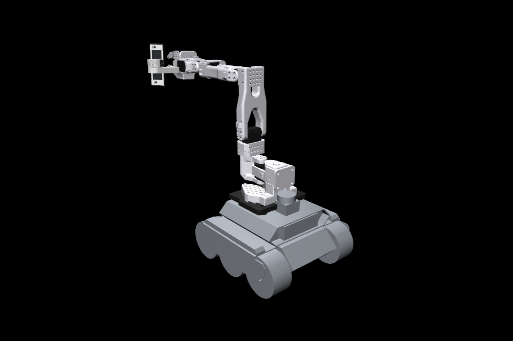

# so101_rover_description

URDF / MJCF of a **Waveshare UGV Rover (Jetson Orin ROS 2 kit)** carrying an **SO-101 follower arm** on a
3D-printed adapter plate, with an **OAK-D Lite** on a tilt mount at the wrist. Built for Isaac Sim, MuJoCo,
Gazebo and RViz.



## What is in the model

| Part | Source | Notes |
|---|---|---|
| Rover body, 4 driven wheels, LiDAR, front OAK-D Lite | Waveshare `ugv_description/urdf/ugv_rover.urdf` (unchanged geometry and inertia) | pan-tilt unit removed; collision = box body + cylinder wheels |
| Adapter plate + 4 spacers | `SO101_UGV_Rover_Mount/FINAL_FILES` (this project's print files) | mass 0.105 kg |
| SO-101 follower arm | TheRobotStudio `Simulation/SO101/so101_new_calib.urdf` | link names prefixed `arm_`, joint names unchanged: `shoulder_pan shoulder_lift elbow_flex wrist_flex wrist_roll gripper` (LeRobot order) |
| Wrist camera tilt mount + OAK-D Lite | `SO101_OAK_Tilt_Mount_v3` | tilt angle is a build parameter (default 45°) |
| Optional arm battery | 3S 26700 pack, 80×27×72 mm, 0.30 kg | `--arm-battery` |

Frames follow ROS conventions: `base_footprint` on the ground, `base_link` 0.08 m up, x forward, z up.
Extra frames: `front_camera_optical_frame`, `wrist_camera_optical_frame` (z = optical axis), `arm_gripper_frame_link`
(between the fingertips), `base_lidar_link`, `base_imu_link`.

## Files

```
urdf/so101_rover.urdf          ROS version   (mesh paths package://so101_rover_description/meshes/...)
mujoco/so101_rover_sim.urdf    plain version (mesh paths ../meshes/...)  -> Isaac Sim, MuJoCo, anything non-ROS
mujoco/so101_rover.xml         MJCF with actuators (position servos on the 6 arm joints, velocity on 4 wheels)
meshes/rover|so101|mount       STL meshes (rover and arm in metres, mount parts in mm with scale 0.001)
scripts/build_urdf.py          regenerates both URDFs from the upstream files in source_models/
tests/check_model.py           parse + kinematics + 3 s MuJoCo simulation + MJCF export + renders
```

## Using it

**Isaac Sim**: File → Import → URDF, pick `mujoco/so101_rover_sim.urdf`. Keep "merge fixed joints" on, set the
wheel joints to velocity drive and the arm joints to position drive. Mesh paths are relative, no ROS needed.

**MuJoCo**: `python -m mujoco.viewer --mjcf mujoco/so101_rover.xml`. Control vector: 6 arm joint targets (rad)
then 4 wheel speeds (rad/s). Or load the URDF directly; it carries a `<mujoco>` compiler block.

**ROS 2**: copy the folder into your workspace, `colcon build`, then
`ros2 launch so101_rover_description display.launch.py` for RViz with joint sliders.

**Regenerate** with different parameters:

```bash
python3 scripts/build_urdf.py --spacer 0.006 --tilt 45          # as built
python3 scripts/build_urdf.py --spacer 0.0                       # plate bolted flat, no spacers
python3 scripts/build_urdf.py --arm-battery                      # add the arm's Li-ion pack
python3 scripts/build_urdf.py --arm-facing front                 # for a mirrored plate (see below)
python3 tests/check_model.py                                     # re-validate
```

## Key dimensions (as modelled)

| | value |
|---|---|
| Top sheet of the rover above ground | 0.120 m (from Waveshare URDF) |
| SO-101 base underside above ground | 0.136 m (0.120 + 0.006 spacer + 0.010 plate) |
| Arm yaw axis, rover frame | x = -0.035 m (75 mm behind the LiDAR centre), y = 0 |
| Total mass | 4.53 kg (rover 3.6, arm 0.63, mount + camera 0.2, no battery) |

## Things to check against the real robot

1. **Arm facing.** With the revision-A plate the SO-101's wide hole pair (its motor-holder end) is toward the LiDAR,
   so the arm's zero-yaw reach direction is toward the **rear** of the rover. The model reproduces that.
   `--arm-facing front` models a mirrored plate (arm hole pattern flipped front to back) that is **not printed yet**.
2. **Fore/aft position of the plate.** It is anchored on the LiDAR (plate front edge 4.8 mm behind the LiDAR housing,
   from the design CAD). Measure LiDAR centre to arm yaw axis: the model says 75 mm. If yours differs, change
   `GAP` in `scripts/build_urdf.py`.
3. **Spacers.** Default 6 mm. Use `--spacer 0` if the plate is bolted straight to the tray.
4. **Wheels.** Waveshare models 4 driven wheels; the middle pair of the 6 is part of the body mesh and not simulated.
5. **Wrist camera tilt.** 7.5° steps, 37.5° is the design reference, default here is 45°.
6. Inertias of the printed parts are box approximations. Rover and arm inertias are the upstream values.

## Licences

Rover meshes and URDF: Waveshare `ugv_ws` (open source, see upstream). SO-101 meshes and URDF: TheRobotStudio
SO-ARM100, Apache-2.0. Adapter, mount and this package: MIT.
